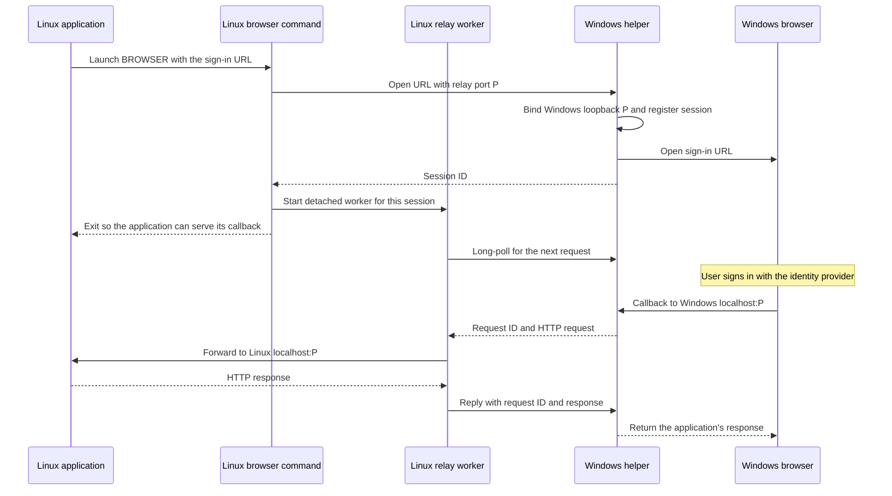

# AuthBridge architecture

A Linux CLI starts an OAuth sign-in and listens on `http://localhost:PORT`. Its browser runs on Windows, where
`localhost` means a different machine. AuthBridge lets the browser use the original redirect URI: it accepts the
callback on Windows, delivers it to the Linux listener, and returns the application's response to the browser.
The browser talks directly to the identity provider. The Linux application still validates OAuth state, redeems
the authorization code, and manages its credentials. AuthBridge does not synchronize browser profiles or tokens.

## Processes and connections

[Program.cs](src/AuthBridge/Program.cs) selects the Windows or Linux commands of the same .NET project.
There is a long-running helper on Windows, but no AuthBridge daemon on Linux.

| Process | Responsibility |
| --- | --- |
| Windows helper (`authbridgew.exe serve` at logon) | [HelperHost](src/AuthBridge/Host/HelperHost.cs) owns the control server, tray, configuration reload, and configured tunnels. [Helper](src/AuthBridge/Host/Helper.cs) opens URLs and owns the active relay sessions. |
| Windows OpenSSH client | [Tunnel](src/AuthBridge/Host/Tunnel.cs) supervises one long-lived SSH connection per target. Each connection creates a fresh reverse-forwarded Unix socket on Linux. |
| Linux browser command (`authbridge` via `BROWSER`) | [Bridge](src/AuthBridge/Client/Bridge.cs) discovers helpers. [BrowserClient](src/AuthBridge/Client/BrowserClient.cs) submits the URL to the selected helper and starts a worker if it receives a session ID. |
| Linux worker (`authbridge __relay`) | [Relay](src/AuthBridge/Client/Relay.cs) polls for browser requests, sends them to the application, and returns its responses. The application, not the worker, owns the Linux listening port. |

**Windows initiates SSH; Linux initiates control requests.** Connecting to `~/.authbridge/bridge-*.sock` on Linux
reaches the Windows helper at `127.0.0.1:28561` by default (`AUTHBRIDGE_PORT` overrides the port). This is the
control port, not the application's callback port. Windows management commands can reach it directly. The helper
reports a tunnel as connected only after the remote command confirms its socket exists. If SSH exits, the helper
retries with backoff capped at one minute.

Several Windows PCs can connect to the same Linux account. For a new open, `Bridge` pings sockets concurrently
and gives the remaining probes up to one more second after the first valid answer. It prefers the PC with the
most recent keyboard or mouse input, breaking ties by newest socket. An existing relay does **not** make this
choice again: it can reconnect only to its original helper, identified by machine name and process ID.

## Opening a URL and returning a callback

The client accepts absolute HTTP(S) URLs. If neither the URL itself nor its decoded `redirect_uri` is an **HTTP
loopback** URL, the helper simply opens the browser and returns no session. Otherwise the port `P` determines
both ends of the relay:

The ordering matters. The Windows listener must exist **before** the browser opens. The browser command must
then exit without leaving its caller's standard streams open: some applications wait for that exit before they
serve a redirect. The worker forwards the method, path and query, end-to-end headers, and body. It does not use
a proxy, share a cookie jar, or follow redirects. Each hop frames its own HTTP message; a form POST reaches the
application, and a `Location` in the reply goes back to the browser.

Shell setup selects `authbridge` only if `BROWSER` is unset or empty. The optional [GCM and NuGet wrappers](src/AuthBridge/Client/Wrappers.cs)
can advertise a desktop display when a helper answers, then replace their own process with the real credential
tool. They enable its existing browser flow rather than implementing a credential provider.

## Control protocol and trust boundary

[ControlClient](src/AuthBridge/Common/ControlClient.cs) speaks HTTP/1.1 over the Unix socket or Windows loopback
TCP. The `Json` context in [Protocol.cs](src/AuthBridge/Common/Protocol.cs) registers the wire messages. A `next`
response wraps an `HttpRequest` in `PendingRequest`; the `reply` body is an `HttpResponse`. Both HTTP records and
their shared `Header` type are defined in [Http.cs](src/AuthBridge/Common/Http.cs) and are part of the wire contract.

Control calls require `Host: authbridge` and `X-AuthBridge` equal to `Protocol.Version` (currently `2`).
Bump `Protocol.Version` for incompatible wire changes, including changes to those HTTP records or their headers.
The `/v1` route prefix is separate from this compatibility check.

| Operation | Contract |
| --- | --- |
| `GET /v1/ping` | Returns protocol version, helper identity, input idle time, active session count, and tunnel status. Discovery requires a valid ping, not just a socket that accepts connections. |
| `POST /v1/open` | Takes the URL, optional relay port, dry-run flag, and client name. Returns a session ID only for a relay. Dry-run skips browser launch, not listener setup. |
| `GET /v1/sessions/{session}/next` | Long-polls for a pending request and its ID. `204` means no work yet; `404` means the session is gone. |
| `POST /v1/sessions/{session}/reply/{request}` | Supplies the application's HTTP response for the waiting browser request. `204` acknowledges it; a retry may see `404` if the request is no longer pending. |
| `POST /v1/sessions/{session}/close` | Releases the Windows callback listeners and cancels pending requests. |

There is one browser-facing route on the control port: for a URL too long to launch reliably, the helper opens
`GET /v1/go/{nonce}` instead. It redirects once to the original URL, expires after five minutes, and does not
require control headers. Callback listeners are separate and bind only Windows loopback (IPv4 and, when available,
IPv6).

SSH protects the inter-machine link; the Linux socket directory is private to the account (mode `0700`). The
control headers keep ordinary web pages out of the API, **not** native processes that can reach the endpoint.
The design trusts those processes and the configured SSH accounts. Callback paths, headers, and bodies can carry
sign-in secrets. URL logging strips the query and fragment; only selected, bounded parameters are logged separately.

## Session ownership and failure behavior

| Event | Required behavior |
| --- | --- |
| No reachable helper, connection lost during open, or `409` (port unavailable or helper restarting) | If the URL supplies a relay port, `redirect_uri`, and `state`, a detached cancellation worker sends the waiting app `temporarily_unavailable` with the original state, as a query or form POST. Without that information, a disconnected client prints the URL for manual opening; a rejected open reports the error. A port conflict must not evict the existing sign-in. |
| Tunnel drops during a relay | [RelaySession](src/AuthBridge/Host/RelaySession.cs) retains the outstanding request and returns the same ID on the next poll. If the worker already forwarded the callback to the app, it retries **the reply**, not the callback. A new SSH socket can recover the session within the retry and expiry limits; a helper restart cannot. |
| Application stops listening | The worker allows an initial one-minute startup window. Once it has seen a listener, loss of that listener ends the relay. A callback that cannot reach the application gets a `502` response. |
| Worker disappears or never answers | The helper expires sessions after two minutes without polling or thirty minutes of total age. A browser request waiting two minutes for its reply gets `504`. Normal worker exit requests session closure rather than waiting for expiry. |

## State, deployment, and updates

- **Windows:** `%USERPROFILE%\.authbridge\config.json` stores named SSH targets, their remote socket directories,
  the optional browser command, and the automatic-update preference. [HostConfig](src/AuthBridge/Host/HostConfig.cs)
  serializes edits under a writer lock and replaces the file. The running helper retains the last valid settings
  on a malformed edit. `host.log` records helper activity; `update.log` records the latest tray update.
- **Tray:** [TrayIcon](src/AuthBridge/Host/Tray/TrayIcon.cs) runs a WinForms message loop on an STA thread.
  `NotifyIcon` manages the Explorer icon; the menu and its Status and About dialogs use the system color mode selected
  at startup. [Status](src/AuthBridge/Host/Tray/StatusDialog.cs) reads the same in-process snapshot as `/v1/ping`
  on opening. While visible, it shows the snapshot used for the tray icon on each two-second tick; it makes no
  network requests. A separate hidden [control window](src/AuthBridge/Host/Tray/TrayControlWindow.cs) owns the
  active dialog and receives stop and idle-update requests addressed to the helper's PID, even without Explorer or
  with a dialog open.
- **Linux:** The client is installed at `~/.local/bin/authbridge`. It locates `~/.authbridge` using the account's
  home directory rather than a caller's `$HOME`. This directory holds tunnel sockets, the client install lock,
  and `client.log`. Relay sessions, pending replies, and one-use browser links live in memory, not in either
  machine's configuration.
- **Distribution:** [release.cs](release.cs) produces self-contained x64 and Arm64 packages. The Linux client is
  trimmed and does not reference Windows Desktop. The Windows target bundles WinForms without trimming. Each Windows
  package carries console and windowless copies of the same executable and both Linux clients. `install-remote` performs
  first installation. Each ready tunnel checks an existing client and upgrades it only if older; the check is
  cancelled and awaited when that connection ends. [RemoteClient](src/AuthBridge/Host/RemoteClient.cs) verifies
  the staged upload's length and executable version, then compares installed versions and renames under a remote
  lock so competing helpers cannot downgrade the client.
- **Helper replacement:** A manual tray check bypasses the polling interval or retry delay and shares any in-flight
  release lookup with the helper. Checking reports the result; a separate manual install action revalidates the
  displayed offer before launching the updater. The updater stages the GitHub release before stopping the helper.
  Automatic installation is opt-in. After staging, the running helper must acknowledge the automatic updater's
  idle-close request while still opted in and free of relays. Accepting that request also blocks new relay registrations; a prior idle
  ping is not sufficient. [InstalledPackage](src/AuthBridge/Host/InstalledPackage.cs) renames old files aside
  before moving replacements into place because Windows can keep a running executable mapped.

[RelayTests](tests/AuthBridge.Tests/RelayTests.cs) exercises the callback round trip and lost-reply behavior;
[TunnelTests](tests/AuthBridge.Tests/TunnelTests.cs) and [UpdaterTests](tests/AuthBridge.Tests/UpdaterTests.cs)
cover connection lifetimes and version replacement. See [AGENTS.md](AGENTS.md) for build and test commands.
